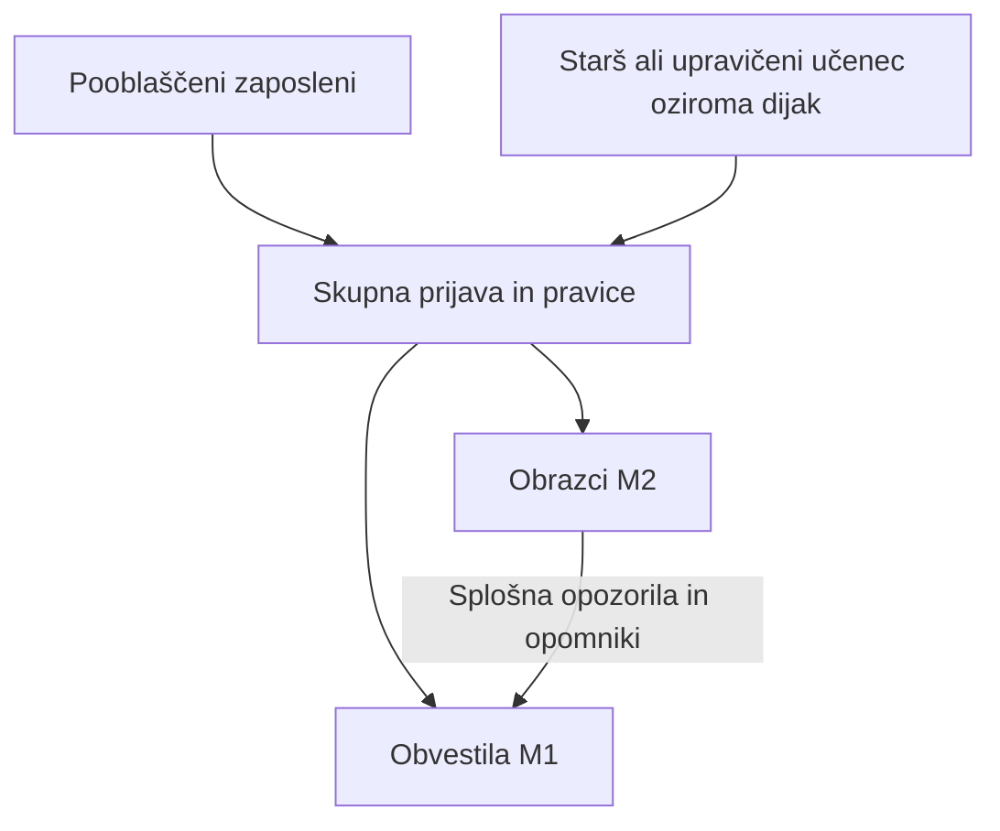

# Predstavitev Odprte šole za prvi mentorski pogovor

Datum: 13. oktober 2026

Status: posodobljena usmeritev pobudnika in predlog za prvo mentorsko oceno; obseg ekip, šolska pravila in uvedba še niso potrjeni

Razvijamo spletno rešitev za eno izmišljeno testno šolo: zaposleni objavi obvestilo ali pripravi obrazec, upravičena oseba pa po prijavi vidi svoje vsebine in izrecno potrdi seznanitev ali odda odločitev. Možnost obveščanja učencev in dijakov je dodaten predlog za presojo mentorja in šole.

**P0 zagotavlja evidenco, prijavo in pravice. M1 obvešča in beleži izrecno seznanitev. M2 zbira odločitve po namenih.** Odprtje vsebine ni potrditev ali dokaz dejanskega branja. Potrditev v M1 ne ustvari odločitve v M2.

Najprej predstavimo projekt in pridobimo človeško oceno. Sprejem skrbništva, varnostnega nadomeščanja in odzivnih rokov obravnavamo pozneje v ločenem dogovoru. Aleksandarju predstavitev ne dodeljuje teh nalog.

## Kako so deli povezani

Vsaka oseba ima svoj račun in svoja dovoljenja, tudi pri skupnem e-poštnem naslovu. Šola potrjuje konkretne pravice iz preverjene evidence; glavni kontakt ali sama povezava starš–otrok ne podelita vseh pravic. E-pošta vsebuje splošno opozorilo, vsebina pa je dostopna po prijavi in preverjanju dovoljenj.

V spodnjih opisih »prva različica« pomeni ciljni celoten učni izdelek B. Ne pomeni, da so vse funkcije že del prve predaje skupne osnove T ali prvega poteka M1 A. Mejnike in omejitve opredeli [razvojno naročilo](../projekt/razvojno-narocilo-P0-M1-M2.md). Predlog za učence je od teh razmejitev dodatno odvisen.

## P0 – Skupna osnova (uporabniki, prijava in pravice)

**Čemu je namenjen:** P0 je temelj, na katerem delujeta M1 in M2. Odgovarja na tri vprašanja:

- **Kdo je kdo:** evidenca oseb, učencev, oddelkov in povezav med starši in otroki.
- **Kdo se prijavlja:** vsaka oseba ima svoj račun in se prijavi enkrat za vse dele aplikacije.
- **Kaj sme kdo videti in storiti:** pravice, ki jih določi šola, se preverijo ob vsakem dejanju.

M1 in M2 sama ne vodita oseb in pravic. Ko starš odpre obvestilo ali odda obrazec, modul pri P0 preveri, ali je to dovoljeno.

**Kdo ga uporablja:**

- pooblaščeni zaposleni, ki uvaža in popravlja evidenco ter potrjuje povezave in pravice;
- starš oziroma skrbnik, ki se z računom prijavi v aplikacijo;
- učenec oziroma dijak z lastnim računom, če ga šola omogoči; polnoletni dijak ima lastno upravičenje po pravilih, ki jih potrdi šola za konkreten postopek;
- modula M1 in M2, ki pri P0 preverjata pravice; samo pooblaščena dostavna storitev M1 pridobi kontakt za konkretno evidentirano dostavo. M2 kontaktov za pošiljanje ne pridobiva.

**Kaj omogoča v prvi različici:**

- uvoz CSV iz šolske evidence s predogledom sprememb, ki se izvede v celoti ali pa se zavrne, nikoli delno;
- ponovni uvoz, ki ne podvoji oseb, ter sledljive ročne popravke;
- povabilo na aktivacijo računa po e-pošti, ki ga šola pošlje po preverjanju osebe in povezave z otrokom;
- lokalno prijavo z uporabniškim imenom in geslom prek preverjene komponente Django;
- ločene račune za vsako osebo, tudi kadar starša uporabljata isti e-poštni naslov;
- možnost računa za učenca ali dijaka, ki vidi samo vsebine, namenjene njemu ali njegovemu oddelku;
- preverjanje pravic ob vsakem dejanju, tako da odvzem povezave ali pravice prepreči novo zaščiteno dejanje in nov prevzem neveljavne dostave. Ravnanje z že prevzetim poštnim poskusom zahteva dogovor v D12.

**Česa ne dela:**

- ne odloča sam o razmerjih: povezavo med staršem in otrokom potrdi šola, uporabnik si je ne more dodati sam;
- e-poštni naslov ni identiteta osebe: aktivacija dokazuje le dostop do predala, ne sorodstva;
- ni nadomestek šolske evidence eA: P0 prevzame že preverjene podatke šole;
- račun učenca ne odpre vsebin in odločitev, namenjenih staršem;
- ne uvaja lastne kriptografije ali lastnega sistema za gesla, ampak uporablja vzdrževano rešitev.

**Kdo ga pripravi:** skupno osnovo pripravi Mitja ob pomoči AI in jo preda dijakom kot izhodišče. Dijaki jo po dogovoru z mentorjem lahko le omejeno razširijo.

**Nadgradnje v naslednji fazi:**

- prijava z ArnesAAI in SI-PASS poleg lokalnih računov, prostovoljno za šolo;
- samodejni prehod v novo šolsko leto, torej prenos oddelkov in članstev;
- dodatna možnost uvoza iz eAsistenta, če se izkaže, da je mogoča, pri čemer CSV vedno ostane.

## M1 – Obvestila (eSporočanje)

**Čemu je namenjen:** šola prek M1 staršem, po izbiri pa tudi učencem in dijakom, pošilja splošna organizacijska obvestila, na primer navodila za športni dan, spremembo urnika ali obvestilo o dogodku. Kadar je pomembno, da prejemnik obvestilo res prebere, šola zahteva izrecno potrditev seznanitve.

**Kdo ga uporablja:**

- zaposleni, ki pripravi in objavi obvestilo za izbrani oddelek ali skupino;
- starš oziroma skrbnik, ki obvestilo prebere in po potrebi potrdi;
- učenec oziroma dijak z lastnim računom, ki prejme obvestila, namenjena njemu ali njegovemu oddelku; prejemnike pri polnoletnem dijaku določi šola po pregledanih pravilih, brez samodejnega odpiranja vseh vsebin za starše.

**Kaj omogoča v prvi različici:**

- dve vrsti obvestil: *informativno* (brez potrditve) in *z zahtevano seznanitvijo* (gumb »Seznanjen/-a sem«);
- izbiro ciljne skupine pri objavi: starši, učenci oziroma dijaki ali oboje; potrditev učenca se beleži ločeno in ne nadomesti potrditve starša;
- predogled vsebine in prejemnikov pred objavo ter priloge (PDF, slike);
- novo različico obvestila ob spremembi, pri čemer prejšnje potrditve ostanejo v zgodovini;
- e-poštno opozorilo s splošnim besedilom in povezavo, vsebina pa je vidna šele po prijavi;
- pregled, kdo je potrdil in kdo še ne, ter opomnike tistim, ki še niso potrdili;
- papirno pot za starše, ki jo izberejo.

**Česa ne dela:** potrditev seznanitve ni soglasje, privolitev ali podpis. M1 ni namenjen uradnemu vročanju, nujnim obvestilom s takojšnjim odzivom ali individualni občutljivi komunikaciji. Ocene, odsotnosti, prehrana in govorilne ure niso del M1.

**Za druge module:** M1 je skupni »poštar« aplikacije. Drugi moduli, najprej M2, prek njega naročijo e-poštna opozorila in opomnike.

**Nadgradnje v naslednji fazi:**

- potisna obvestila v telefon kot dopolnitev e-pošte, posebej uporabna za učence in dijake;
- razširjen vmesnik, prek katerega bodo poleg M2 obveščali tudi drugi moduli;
- samodejni prehod v novo šolsko leto za oddelke, skupine in prejemnike;
- naprednejše upravljanje prevodov in skupin, saj je podpora več jezikom predvidena že od začetka.

## M2 – Obrazci (eSoglasja)

**Čemu je namenjen:** šola prek M2 od staršev zbira izrecne odločitve za posameznega otroka, na primer soglasje za udeležbo pri dejavnosti ali privolitev v objavo fotografij. Vsak namen ima svojo izbiro »Da« ali »Ne«.

**Kdo ga uporablja:**

- zaposleni, ki pripravi obrazec in spremlja odzive;
- starš oziroma skrbnik, ki odda odločitev za svojega otroka;
- mladoletni učenec z računom za obvestila ne odloča namesto staršev; pri polnoletnem dijaku šola potrdi odločevalce in podlago konkretnega postopka. Ali in kdaj učenec vidi obrazec, ki se ga tiče, določi šola.

**Kaj omogoča v prvi različici:**

- obrazec z enim ali več nameni, pri čemer se odločitev za vsak namen hrani ločeno;
- oddajo za enega otroka naenkrat, za več otrok se postopek ponovi;
- jasno razlikovanje med »brez odziva« in »Ne«, pri čemer potek roka ne pomeni pritrdilne odločitve;
- potrdilo staršu in celotno zgodovino odločitev;
- spremembo ali preklic privolitve za posamezen namen, ki je enako preprost kot oddaja;
- nalogo za odgovornega zaposlenega, kadar preklic zahteva ukrepanje zunaj aplikacije;
- e-poštne opomnike za neizpolnjene obrazce, ki jih pošilja prek M1.

**Česa ne dela:** elektronska oddaja ni kvalificiran elektronski podpis. Prvi pilot ne vključuje zdravstvenih vprašalnikov, pooblastil za prevzem otrok, plačil ali uradnih upravnih postopkov. Klik »Seznanjen/-a sem« v M1 ne ustvari odločitve v M2.

**Nadgradnje v naslednji fazi:**

- skupinska oddaja za več otrok z jasnim pregledom, za katere otroke starš odloča;
- zahtevnejši urejevalnik obrazcev s pogojnimi vprašanji;
- dodatni pregledani postopki in povezave z drugimi moduli (M3–M6);
- povezave z državnimi storitvami in storitvami za elektronski podpis, kadar jih postopek zahteva;
- napredni prevodi in usklajevanje jezikovnih različic obrazcev;
- samodejne naloge v zunanjih sistemih, na primer ob preklicu privolitve;
- nadzorovan prenos zgodovine odločitev in obnova obrazcev za novo šolsko leto.

## Učenci in dijaki kot prejemniki obvestil [P]

Učencem in dijakom so lahko neposredno namenjena organizacijska obvestila, na primer o urniku, športnem dnevu ali ekskurziji. Pobudnik zato predlaga možnost njihovih individualnih računov in obveščanja. Vključitev v prvi učni obseg še presodita mentor in šola.

**Predlog:**

- učenec oziroma dijak lahko dobi svoj račun v P0; račun je vezan na njegov zapis v evidenci, ne na račun staršev;
- pri objavi obvestila zaposleni izbere ciljno skupino: starši, učenci oziroma dijaki ali oboje;
- učenec vidi samo obvestila, namenjena njemu ali njegovemu oddelku; obvestil, namenjenih samo staršem, in odločitev staršev ne vidi;
- potrditev seznanitve učenca se beleži ločeno in ne nadomesti potrditve starša;
- odločitve v M2 za mladoletnega učenca oddaja upravičena oseba; pri polnoletnem dijaku se uporabijo posebej potrjena pravila;
- e-pošta učencu vsebuje samo splošno opozorilo in povezavo, enako kot staršem.

**Odloči šola, potrdi pravni in podatkovni pregled:**

- od katerega razreda oziroma starosti učenci dobijo račun (npr. od predmetne stopnje ali šele v srednji šoli);
- na kateri e-naslov se obveščajo: šolski e-naslov, ki ga zagotovi šola, ali osebni;
- kako se učencu izda račun: v šoli ali prek staršev;
- ali in kdaj učenec vidi obrazec M2, ki se ga tiče, in stanje odločitve;
- pravila za mladoletne uporabnike glede osebnih podatkov in privolitev (D07/D16).

**Vpliv na obseg:** P0 doda vrsto računa za učenca, M1 izbiro ciljne skupine pri objavi. Zahtevnost še ni ocenjena; mentor presodi celoten vpliv na račune, ciljno skupino, zasebnost in preizkuse ter predlaga prvo različico ali naslednjo fazo.

## Skupno za celotno aplikacijo

**Uvoz podatkov iz šolske evidence:**

- uvoz CSV ostane osnovni način prenosa podatkov in je vedno na voljo;
- ali eAsistent omogoča izvoz v ustrezni obliki ali programski vmesnik (API), še ne vemo; šoli smo poslali vprašanje, odgovora še ni;
- če se izkaže, da je povezava mogoča, se lahko pozneje doda kot **dodatna** možnost poleg uvoza CSV, ne kot njegova zamenjava; do takrat povezave z eAsistentom ne načrtujemo.

**Namestitev:**

- vsaka šola ima svojo namestitev in v izvedbenem dogovoru določi skrb za strežnik, podatke, varnostne kopije, posodobitve in dostope; to še ne imenuje skrbnika ali potrjuje virov šole;
- centralne namestitve za več šol ne predvidevamo;
- za drugo šolo se ista odprtokodna rešitev namesti ločeno, s svojimi podatki.

*Nadgradnje niso del učnega izdelka. Rok, izvajalci in vrstni red niso določeni; obseg in morebitne premike med fazami predlaga mentor.*

## Osem izmišljenih primerov za primerjavo

| Primer | M1 obvestilo in seznanitev | M2 obrazec in odločitev |
| --- | --- | --- |
| 1 Informacija | Knjižničarka objavi urnik knjižnice. Starš ga prebere; potrditev ni zahtevana. | Obrazec ni potreben. |
| 2 in 3 Športni dan | Učiteljica objavi zbirno mesto in opremo. Starš izrecno potrdi seznanitev za otroka in različico. | Za fotografije istega dogodka v testnem obrazcu izbere Da za spletno objavo in Ne za letopis. Seznanitev z navodili teh odločitev ne ustvari. |
| 4 in 5 Sprememba | Novo zbirno mesto pomeni novo različico navodila in novo zahtevano seznanitev; prejšnja ostane v zgodovini. | Po dovoljenih pravilih starš spremeni izbiro za spletno objavo; drugi namen in zgodovina ostaneta ohranjena. |
| 6 in 7 Dva otroka | Starš izbere A in B za seznanitev. Če je pravica za B odvzeta, se nova skupinska potrditev ne shrani niti za A niti za B. | Za A odda odločitev posebej, nato za B posebej, z možnostjo različnih izbir. Prvi M2 obravnava enega otroka naenkrat. |
| 8 Opomnik za obrazec | M1 dostavi splošni opomnik, ki ga naroči M2. Dostava ali klik povezave ne ustvarita odločitve. | M2 ostane lastnik obrazca in odločitve. Izpolnjen obrazec z odgovori Ne je odgovor; neizpolnjen obrazec ni zavrnitev. |

Primeri niso pravno ali vsebinsko potrjeni obrazci za uporabo na šoli. Potrditev ene osebe ne ustvarja odziva druge; skupno obravnavo določi šola. Že predane pošte ni mogoče priklicati; podrobna dostavna pravila se uskladijo v D12.

## Kaj vidi uporabnik

| Zaslon M1 | Zaslon M2 |
| --- | --- |
| Obvestilo: Športni dan, različica 1 | Obrazec: Objava fotografij, konkretna različica |
| Navodilo in dovoljene priloge po prijavi | Pregledano besedilo in ločeni nameni po prijavi |
| Izbira dovoljenih otrok A/B za seznanitev | En otrok; za spletno objavo in letopis ločena izbira Da/Ne |
| Gumb: Potrdi seznanitev | Gumb: Oddaj izbire |
| Rezultat: kdo je za kateri obseg potrdil različico in kdaj | Rezultat: otrok, namen, izbira, različica in čas |

Skici sta opis vsebine, ne delujoča zaslona. M2 ne zahteva predhodne potrditve seznanitve v M1.

## Predlog razdelitve in zaporedja

Mitja je osebno prevzel skupno osnovo ter pripravo predloga vmesnikov, testnih primerov, nadomestkov in navodil ob pomoči AI. Mentor oceni primernost za dijake in določi njihove samostojne izdelke. Dijaki razvijajo predvsem M1/M2 in povezavo; šola uporabnica določa svoje postopke, pravice in poznejšo uporabo.

Predlagana osnova je Django 5.2 LTS/Python, PostgreSQL in Docker Compose za razvojno okolje. Mitja jo je osebno izbral; mentorji in tehnični nosilec morajo potrditi skupni dogovor. Točne podprte izdaje in cilj namestitve še niso določeni. Za razvoj uporabljamo lokalne račune, CSV in testno pošto, brez dejanskih šolskih podatkov ali integracije eAsistent.

Približno tri Mitjeve ure tedensko so okvir za vodenje, usklajevanje in preglede; ne pokrivajo izdelave P0. Predlog 2–3 dijakov na modul ni potrjena razpoložljivost ali rok.

1. Predstavitev, mentorska ocena in potrebni dogovori pred prvo kodo.
2. Priprava in preverjen prevzem skupne osnove, pogodbe, navodil in testnih podatkov.
3. Prvi potek M1: objava, splošno opozorilo, prijava, ogled in izrecna seznanitev.
4. Povezava M2 z M1, nato celoten učni izdelek. Morebitna uporaba na šoli ima ločen prevzem.

Sedanji načrt zahteva neodvisen človeški prevzem T; Mitjev predlog avtorskega pregleda ob pomoči AI še ni institucionalno potrjen. Prav tako ni sprejeta izjema za lokalne prototipe pred D03/D09/D14.

## Vprašanja za mentorja

- Ali je cilj primeren za učni oziroma maturitetni izdelek?
- Katere samostojne naloge so primerne za posamezne dijake?
- Kaj bi zaradi znanja, časa in razpoložljivosti omejil ali spremenil?
- Katere tehnične informacije potrebuje pred oceno izvedljivosti?
- Ali računi in obveščanje učencev/dijakov sodijo v prvi učni obseg ali v naslednjo fazo?

Za prvi stik uporabimo [spremno sporočilo](prvi-pogovor.md). Naslednja raven sta [razvojno naročilo](../projekt/razvojno-narocilo-P0-M1-M2.md) in [kratka tehnična specifikacija](../arhitektura/kratka-specifikacija-P0-M1-M2.md). [Register](../projekt/odlocitve.md) loči projektno usmeritev od formalnih potrditev.
